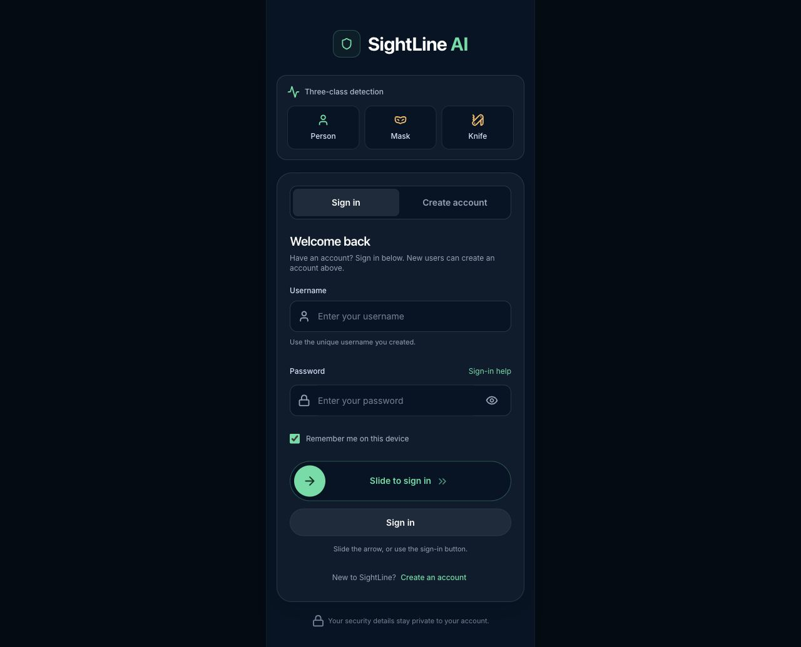
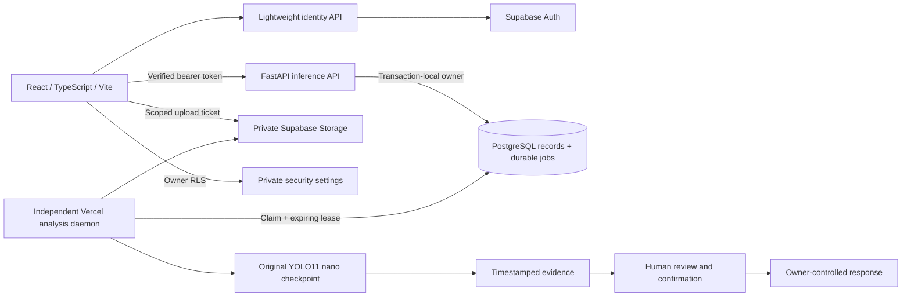

# SightLine AI

**Find the moment. Review the evidence. Choose the response.**

[](https://github.com/BuildWithShaurya-code/sightline-ai/actions/workflows/ci.yml)

SightLine turns camera footage into private, reviewable **person, mask and knife** detections. It combines a trained YOLO11 nano model with captured evidence, separate user accounts and an operator-controlled response workflow.

[**Open the live app**](https://sightline-ai-eight.vercel.app) · [Source](https://github.com/BuildWithShaurya-code/sightline-ai) · [Two-minute demo](docs/DEMO_SCRIPT.md) · [Setup](docs/SETUP.md) · [Verification](docs/VERIFICATION.md)

Prepared for **HYPNEXIS’26 · Manipal University Jaipur · 24–25 October 2026**. This is a working prototype prepared before the event. The contribution record explicitly distinguishes existing work, AI-assisted repairs and work to be completed during the hackathon.



## The problem

A security operator can have hours of footage and little time to inspect it. SightLine helps locate a relevant moment, inspect the model's evidence and keep a record of the operator's decision. It supports review; a mask or object prediction is not proof of theft or criminal intent.

## Try the workflow

1. Choose **Create account** and set your own unique username and password. No email confirmation or shared demo password is required.
2. Add your property location and security contact. Those details belong to your account.
3. Open **Studio** and upload a supported video or allow your browser camera.
4. A mask prediction at **60% confidence or above** can show a warning and sound the browser siren. Lower-confidence predictions can still appear in the results.
5. Press **Confirm Threat** to open the captured photo immediately. If its upload is still running, the screen labels it as a local preview; confirmation and response controls wait for the real server acknowledgement.
6. Review evidence, timestamps and confidence. Open response actions only after confirmation. Calls and WhatsApp drafts stay under your control.
7. Dismiss a false alarm with a required reason and an uninterrupted three-second hold, or revisit your account's History.

**Notification scope:** on-screen warnings and browser audio are implemented. Desktop notifications require browser permission. Server dispatch defaults to an explicitly labelled simulation; the app does not automatically contact police or emergency services.

## What is implemented

| Capability | Current behavior |
| --- | --- |
| Accounts | Unique username/password registration, real Supabase sessions, no default account or PIN |
| Private setup | Property location, security contact and optional WhatsApp number, protected by owner RLS |
| Video analysis | Scoped direct upload, actual video validation, durable queue and independent inference worker |
| Live camera | Real frame inference through the API; person/mask/knife predictions and inclusive 60% mask-warning threshold |
| Evidence | Exact captured photos, model boxes, confidence and timestamps; up to three automatic photos per episode |
| Confirmation | Immediate photo view; honest pending/error/retry states while upload and confirmation complete |
| History | Persisted account-owned records, search, date/status filters and pagination; recent pages refresh in the background |
| False alarms | Required reason, cancellation of a partial hold, recorded dismissal and cleared visible evidence |
| Response | Saved contact/location, reviewed call/WhatsApp actions and a response journal; no invented delivery acknowledgement |

## Architecture



The frontend, identity API and inference API are separate Vercel services under one domain. A daemon consumes the durable queue. PostgreSQL stores owners, jobs and incident records; private object storage holds videos, evidence and the checkpoint. Container scratch files are caches, rather than the only copy of a job or photo.

The original model is provisioned privately and its checksum is verified. The API fails closed when authentication or model readiness is unavailable. Queue leases make interrupted processing visible instead of silently claiming success.

## Run locally

Tested development environment: **Node 24 · Python 3.12 · macOS arm64**. Hosted images use Linux amd64 CPU inference wheels.

```sh
npm ci
python3.12 -m venv qa/.venv
qa/.venv/bin/python -m pip install -r backend/requirements.txt
cp .env.example .env.local
cp backend/.env.example backend/.env
```

Configure your own Supabase project using [SETUP.md](docs/SETUP.md) and [CLOUD_DEPLOYMENT.md](docs/CLOUD_DEPLOYMENT.md). Username registration requires the private cloud schema/aliases, Auth configuration and server key; copying example files alone is insufficient. Set `STORAGE_BACKEND=supabase` and the documented durable-storage variables in the backend environment. Use only the publishable key in the browser.

Provision the authorized checkpoint as `backend/models/best.pt`:

```text
SHA-256  0b17d4a5f108447e277dce5688ecd1d3924a43792f2d751c018858d9539dc0f8
```

Start the API and frontend in separate terminals:

```sh
# Terminal 1, from backend/
../qa/.venv/bin/python -m uvicorn app.main:app --host 127.0.0.1 --port 8000

# Terminal 2, from the repository root
npm run dev
```

Open [localhost:3000](http://127.0.0.1:3000). The development proxy routes `/api` to port 8000. For queued video work, run a worker with your cloud configuration, or use your already-configured hosted worker:

```sh
# Terminal 3, from backend/
CLOUD_WORKER=true ../qa/.venv/bin/python -m app.cloud_worker
```

The local-only SQLite mode remains available for inference rehearsals, but does not replace private cloud username-account provisioning. Supabase authentication and private contact saving require internet access. `scripts/start_demo.sh` can instead build and serve the UI together with the local API on port 8000.

## Configuration boundaries

| Browser `.env.local` | Backend / hosted runtime only |
| --- | --- |
| `VITE_SUPABASE_URL` | `SUPABASE_URL` |
| `VITE_SUPABASE_PUBLISHABLE_KEY` | `SUPABASE_PUBLISHABLE_KEY`, `SUPABASE_SECRET_KEY` |
| `VITE_API_URL` — blank for same-origin routing | `CLOUD_DATABASE_URL`, `CLOUD_DATABASE_CA` |
| `VITE_CLOUD_UPLOADS=1` for cloud direct uploads | `STORAGE_BACKEND=supabase`, model/storage settings |
| No server credentials | Independent `SESSION_SECRET`; `DISPATCH_PROVIDER=simulation` by default |

Keep server secrets in gitignored environment files or the host's secret settings. Never put a secret/service-role key, database password, owner contact, token or footage in the frontend, README or repository.

## Deploy the complete app

Use the existing [Vercel configuration](vercel.json) and [step-by-step cloud guide](docs/CLOUD_DEPLOYMENT.md). It includes the frontend, lightweight identity container, inference container and independent analysis daemon. A static frontend deployment alone cannot run the Python model or process queued videos.

Provision the private schema and buckets, TLS database access, runtime secrets and original checkpoint before a release. Hosted video uploads are bounded at **50 MiB** and go directly to private storage through scoped tickets. Stage a production build, verify its API/storage/model/account boundaries, then promote the tested build and check the newly started worker. Preserve a rollback target.

Vercel Services and Daemons are beta platform features; availability, resource limits and costs depend on the intended account. [Official Services docs](https://vercel.com/docs/services) · [Official Daemon docs](https://vercel.com/docs/daemons).

## Verification and reproducibility

Latest release checks, 19 October 2026 (local and hosted checks are distinguished below):

| Check | Observed result | What it establishes |
| --- | --- | --- |
| Backend suite | **189 passed** | Auth, ownership, inference contracts, queue/recovery, evidence, review, PIN and response behavior; some providers are mocked |
| Frontend checks | **14 scripts passed** | Validation, account isolation, routes, alert thresholds, slider/hold input, cache behavior, capture transfer and pending confirmation |
| Public model-free backend subset | **81 passed** | Reproducible contracts without private checkpoint or footage |
| Hosted release | **READY; workflow passed** | Real registration/login, ownership, private evidence, original-model inference and a job completed by the new cloud daemon |
| Frontend compiler/build | Passed | TypeScript and production Vite bundle |
| Deployment preflight | 14 unsafe/missing settings rejected | Public/server environment boundary checks |
| Connected workflow | Passed with disposable accounts | Real Auth/SDK/API, original model, signed evidence, private contacts/history and cross-owner denial |
| Browser interaction | Passed | Immediate preview, pending upload, failure/retry, real History images and non-blocking return navigation |

A controlled browser test measured **29.4 ms from Confirm Threat to a decoded photo preview while upload was deliberately paused**. A separate real-backend run made the first captured photo available to the UI in under 1 ms before waiting for upload/confirmation. These are different local measurements, not hosted latency promises. Server acknowledgements remain asynchronous. Representative accuracy, positive knife cases, hosted concurrency and real notification delivery need separate evaluation.

GitHub’s clean Linux run passed both jobs for commit `eaf3afa`: frontend install/lint/build and behavior checks, plus backend dependency installation, `pip check` and the model-free tests. [Verified run](https://github.com/BuildWithShaurya-code/sightline-ai/actions/runs/39281684819). A fresh public clone also matched all 193 reviewed source/asset hashes.

Reproduce the public checks:

```sh
npm run lint
npm run build
node scripts/check-vercel-preflight.mjs
for check in qa/*_checks.cjs; do node "$check"; done
python3 scripts/export_review_package.py --check
```

[GitHub Actions](.github/workflows/ci.yml) also installs the declared dependencies and runs the model-free backend security/contract tests. The complete backend suite additionally requires the private original checkpoint and authorized fixtures:

```sh
qa/.venv/bin/python -m pytest backend/tests -q
```

The production release is `dpl_HYKP2t9UsZE6t8EDUeorhP94WvNf`, served from Tokyo with the original checkpoint loaded. A hosted positive mask fixture returned 89%, an empty scene produced no mask/knife result, and a generated negative video completed through the new worker. No private test media is distributed in this repository.

See [VERIFICATION.md](docs/VERIFICATION.md) for environment-specific results, historical runs and the distinctions between synthetic fixtures, mocks, real model execution and browser checks. A positive mask fixture is not a dataset-wide accuracy score.

## Repository map

```text
src/                  React screens, camera flow, typed client and account state
backend/app/          FastAPI, verified identity, persistence and model/worker logic
backend/tests/        Backend regression and security contracts
qa/*_checks.cjs       Frontend behavior/rendering/transport checks
supabase/migrations/  Owner-scoped settings and private durable-cloud schema
scripts/              Preflight, source export, cloud checks and local startup
docs/                 Setup, API/model contracts, demo and verification records
.github/              Reproducible CI and contribution templates
```

Private environment files, databases, model weights, footage and owner data are intentionally excluded. The README screenshot shows the actual app with empty sign-in fields.

## Hackathon demonstration

Use the [two-minute demo](docs/DEMO_SCRIPT.md): create an account, enter dummy property/contact details, show a consented positive capture, confirm and inspect evidence, then show false-alarm handling and persistent history. Include an empty-scene control. Use an already completed analysis only when clearly identified as a previous run. Show a live recording fallback if connectivity fails; do not fake progress or detection outcomes.

The [HYPNEXIS submission plan](docs/HYPNEXIS_SUBMISSION.md) includes the problem framing, architecture, validation and a contribution record. Confirm the event's reuse rules and final problem statement. The existing app/model and these pre-event changes must be disclosed; this repository does not claim they were built entirely during the 36-hour event.

## Limits, licensing and attribution

This is a human-review prototype. It does not identify criminals, prove a theft, identify faces, ingest arbitrary RTSP hardware or guarantee emergency response. Browser sirens are software audio. Real dispatch-provider delivery, representative accuracy and production-scale load remain unmeasured.

**Application license is pending owner review.** Public source availability does not grant a new license to the app or model. Ultralytics has AGPL-3.0 and enterprise licensing options; model/data distribution rights and applicable obligations must be resolved before redistribution. See [THIRD_PARTY_NOTICES.md](THIRD_PARTY_NOTICES.md) and [MODEL_CARD.md](docs/MODEL_CARD.md).

[Security](SECURITY.md) · [Contributing](CONTRIBUTING.md) · [API contract](docs/API_CONTRACT.md) · [Operations](docs/OPERATIONS.md) · [Submission checklist](docs/SUBMISSION_CHECKLIST.md)
